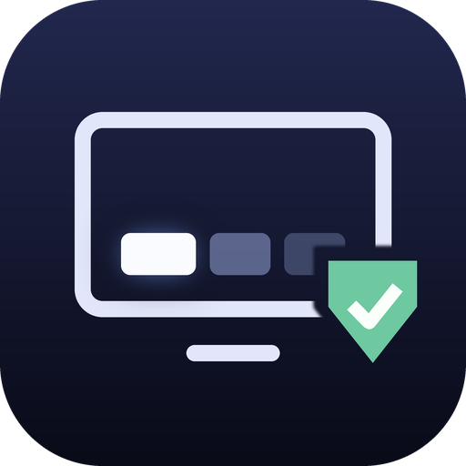
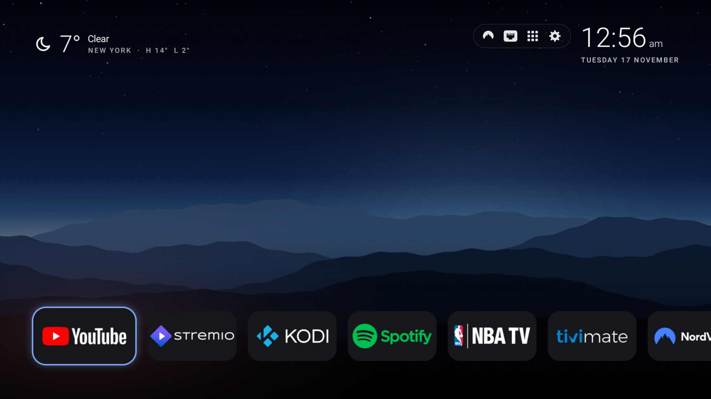
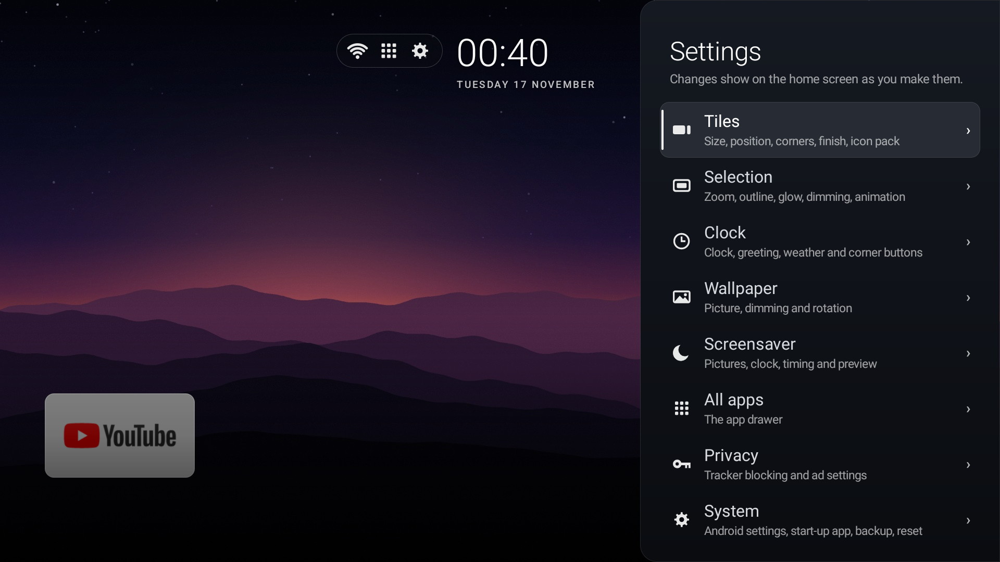
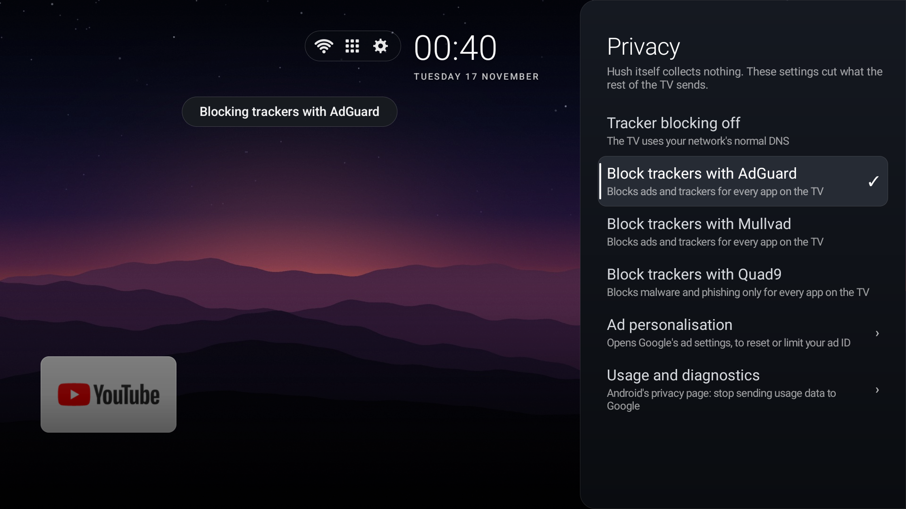
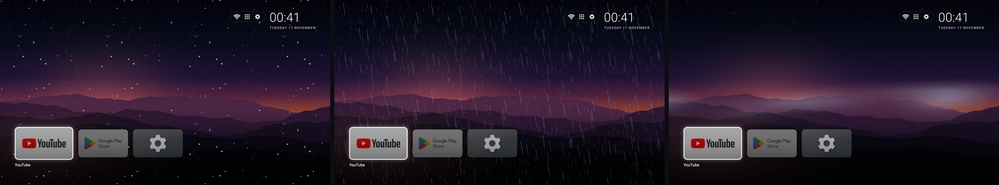

# Hush Launcher



[](https://github.com/hush-tv/HushLauncher/releases/latest)
[](LICENSE)


Hush is an ad-free home screen for Android TV and Google TV. It replaces the stock launcher's
sponsored rows, recommendations and autoplaying trailers with a single row of the apps you choose, a
wallpaper and a clock.

It is free, open source, about 3 MB, and has no account, analytics or advertising.

**Install on your TV:** enter code **2573570** in the Downloader app.



| | |
|---|---|
|  |  |



## Features

**Home screen**
- One row of apps, chosen and ordered by you. The selected tile stays in place and the row
  glides beneath it.
- Corner buttons for network status, VPN status, all apps and settings.
- Optional app names, greeting, clock (12 or 24 hour, top left or right, three sizes) and local weather.
- Corner icons can be hidden.
- Tiles can fade out when the remote is left alone, leaving only the wallpaper and clock.

**Look and feel**
- Tile size, position, spacing, corner shape and finish (flat, glass or deep), a dark tile
  style, and softening of very bright tile artwork.
- Selected-tile effects: zoom, outline in a choice of colours or one taken from the wallpaper,
  glow, a soft pool of light in the app's own colour, and a light sweep across the tile.
  Other tiles can be dimmed, and animation speed set to instant, fast or smooth.
- Icon packs: installed Android icon-pack apps or folders of images, previewed live on your
  own tiles. Any tile can also be given a picture of its own.

**Wallpaper**
- Fifteen built-in wallpapers, or your own pictures from the TV's storage or a USB drive.
- Gallery with thumbnails and a live preview.
- Follows the time of day, darkens at night, optional blur and dimming, and rotation through
  your own pictures.
- Live weather effects: rain, storms, snow, drifting cloud and fog, matched to the current
  weather where you live. Stars appear on clear nights.

**Screensaver**
- Slowly drifting scenes with a large clock, the date and the weather.
- The clock moves continuously to avoid screen burn-in.
- Can show the current wallpaper, your own pictures, or a dim clock on black instead, changing
  every 1, 5 or 15 minutes, at three brightness levels.

**Privacy**
- Tracker blocking for the whole TV (see below).
- Shortcuts to the TV's ad-personalisation and usage-data settings.

**Everything else**
- All apps drawer (5, 6 or 7 columns) with your home-row apps first.
- Hold OK on a tile to move it, change its picture or remove it.
- Open a chosen app automatically at start-up.
- Back up all settings to a file and restore them later.

## Privacy

**What Hush collects:** nothing. Hush has no account, analytics, crash reporting or ads. It makes
only two kinds of network request: the optional weather (see [Weather](#weather)), off by
default, and the update check (see [Updates](#updates)), which asks GitHub once a day whether a
newer version exists and can be switched off.

**Tracker blocking (Android 9 or newer):** Settings → Privacy can switch the TV to an encrypted DNS service that
refuses to look up known advertising and tracking domains. It applies to every app on the TV
that uses the system's DNS, not only the home screen. After switching, Hush checks the
connection; if the service can't be reached from your network, the previous setting is put back
automatically.

| Choice | What it blocks |
|---|---|
| AdGuard | Many ads and trackers |
| Mullvad | Many ads and trackers |
| Quad9 | Known malware and phishing sites |

This uses Android's built-in Private DNS feature, which needs Android 9 or newer; on Android 8
the tracker-blocking choices are not shown. Android only lets an app
change it after one command from a computer:

```bash
adb shell pm grant com.hushtv.launcher android.permission.WRITE_SECURE_SETTINGS
```

**Limits:**

- DNS blocking stops most tracking and ad *servers*. It cannot block data an app sends through
  its own servers, and some ads (YouTube's, for example) are served from the same addresses as
  the videos, so they are not blocked.
- If a VPN is running, the VPN's own DNS is used instead.
- Google Play Services and Android itself still talk to Google. Hush removes Google's home-screen
  recommendations, but it cannot switch off the operating system's own reporting. The
  "Usage and diagnostics" shortcut opens the setting that turns most of it off.
- On a TV with Android built in (Sony, TCL, Philips and others), the TV's own firmware may
  analyse what is on screen (often called ACR, "automatic content recognition"). That runs
  below Android and has to be switched off in the TV's own privacy menu.
- LG (webOS) and Samsung (Tizen) TVs do not run Android and cannot use Hush. A streaming box
  such as a Shield or Chromecast, plugged into such a TV, keeps its own apps away from the TV's
  smart features, but the TV's own ACR should still be switched off in its settings.

## Compatibility

| Device | Status |
|---|---|
| Nvidia Shield TV (all models) | Fully tested |
| Chromecast with Google TV, Google TV Streamer, onn, Xiaomi Mi Box | Supported |
| TVs with Android TV or Google TV built in | Supported |
| Amazon Fire TV and Fire TV Stick | Supported; Home button through the [Hush Home button](#home-button-on-fire-tv-and-google-tv) service |
| Android TV boxes (Formuler, Dynalink, Homatics and others) | Supported |
| Apple TV, Roku, Samsung (Tizen), LG (webOS) | Not possible: these do not run Android apps |
| Android phones and tablets | Not supported: Hush is designed for a remote, not touch |

Requires Android TV, Google TV or Fire OS based on Android 8 or newer. On lower-powered devices, the weather effects and glow can be
reduced or switched off in Settings.

## Installation

The latest version is always available at:

```
https://github.com/hush-tv/HushLauncher/releases/latest/download/launcher.apk
```

### On the TV (no computer needed)

**1. Install Downloader.** Search for **Downloader** (by AFTVnews, orange icon) in the Google
Play Store or the Amazon Appstore and install it.

**2. Allow Downloader to install apps.** Android asks for this once, per app.

- **Google TV / Android TV:** if Downloader doesn't ask by itself, go to Settings → Apps →
  Security & restrictions → Unknown sources → turn on **Downloader**. On some Google TV devices
  this option only appears after turning on developer mode: Settings → System → About → press
  **Android TV OS build** seven times.
- **Fire TV:** Settings → My Fire TV → About → press your device's name seven times, press Back,
  then Developer options → Install unknown apps → turn on **Downloader**.

**3. Install Hush.** Open Downloader, enter the code **2573570** and choose **Install**.

**4. Open Hush.** Choose **Open** at the end of the install. Later you can find it under
Apps → See all apps (Google TV) or by holding Home → Apps (Fire TV); it is near the end of the list.

**5. Follow Get started.** The guide opens by itself the first time and walks through:
- **Making Hush your home screen.** Opens the TV's home-screen setting. On TVs without one
  (Fire TV and most Google TV devices) it opens Accessibility instead: turn on
  **Hush Home button**, and the Home button opens Hush. On Fire TV, Amazon's home screen may
  flash for a moment before Hush appears; that is expected.
- **Choosing your apps**, **picking a wallpaper**, **showing the weather** and **privacy**.

The row starts with the apps already on your TV.

### With Claude or another AI assistant

An assistant that can run commands on your computer can find the TV on your Wi-Fi and do the
whole setup, including tracker blocking. See [Set up with an AI assistant](SETUP_WITH_CLAUDE.md)
for the prompt to paste and the steps it follows.

### From a computer, by hand

Turn on developer options on the TV, then turn on **USB debugging** / **Network debugging**
(Fire TV: **ADB debugging**) in Developer options and note the TV's IP address:

- Android TV: Settings → Device Preferences → About → press **Build** seven times.
- Google TV: Settings → System → About → press **Android TV OS build** seven times.
- Fire TV: Settings → My Fire TV → About → press the device name seven times.

```bash
adb connect <tv-ip>:5555
adb install launcher.apk
adb shell cmd package compile -m speed -f com.hushtv.launcher
adb shell cmd package set-home-activity com.hushtv.launcher/.HomeActivity
adb shell pm grant com.hushtv.launcher android.permission.WRITE_SECURE_SETTINGS
```

The compile step makes Hush start faster and use less memory. The last command allows tracker
blocking. `tools/install.sh <tv-ip>` runs the first four.

## Controls

| Button | Action |
|---|---|
| Left / Right | Move along the row |
| OK | Open the selected app |
| Hold OK | Tile options: move, change picture, remove |
| Up | Corner buttons (network, VPN, all apps, settings) |
| Down | All apps, if Settings → All apps → Down opens all apps is on |
| Menu | All apps |
| Back | Close the open panel |

## Customisation

Hush reads these folders under `/sdcard/Android/data/com.hushtv.launcher/files/`:

| Folder | Contents |
|---|---|
| `wallpapers/` | Your own wallpapers |
| `tiles/` | Custom tile pictures, named after the app's package (for example `org.xbmc.kodi.png`) |
| `packs/<Pack name>/` | An icon pack as a folder of images named after each app's package |

Files can be copied with `adb push` or from a USB drive using the TV's file manager.

## Getting back to the normal home screen

- **Open the TV's settings from Hush:** press Up, then the gear icon, then System → Android settings.
- **Stop the Home button opening Hush:** turn off **Hush Home button** in Accessibility, or choose
  the TV's own launcher in its home-screen setting.
- **If the Home button keeps bouncing to Hush** when you don't want it to, Hush pauses the
  Home button service by itself after several quick repeats, so the TV's home screen stays up for a
  minute while you turn it off.

## Uninstalling

1. Turn off **Hush Home button** in Accessibility if you use it, and if tracker blocking is on,
   set Settings → Privacy → **Don't block**. Android keeps both after an app is removed.
2. Remove Hush from the TV's Settings → Apps, or with `adb uninstall com.hushtv.launcher`.
3. Press Home. The TV goes back to its own home screen. If you set Hush as the home screen over
   adb, that choice is cleared automatically when Hush is removed.


## FAQ

**Is there more than one row?** No. Hush shows one row of the apps you choose; everything else
is in the All apps drawer (Up, then the grid button).

**Do I need a computer?** No, except for tracker blocking (one command), and on Fire TV versions
that hide Hush Home button from Accessibility. An [AI assistant](SETUP_WITH_CLAUDE.md) can do
both for you.

**Does the TV switch back to its own home screen after a system update?** Usually not. If it
does, press Home and choose Hush again, or run the `set-home-activity` command.

**How do I update?** Settings → System → Updates. Or download the newest `launcher.apk` and
install it over the old one. Your settings are kept either way. [Obtainium](https://github.com/ImranR98/Obtainium) can check this page for
updates automatically.

**Will YouTube ads be blocked?** No. YouTube serves ads from the same addresses as videos, so no
DNS-based blocker can remove them.

**Where do I report a problem?** [Open an issue](https://github.com/hush-tv/HushLauncher/issues/new/choose)
with your device model and Android version.

## Weather

Weather is provided by [Open-Meteo](https://open-meteo.com) and is off by default. When you set
a town (Settings → Clock → Weather town), its name is sent once to find its location. After
that, Hush sends only that location, rounded to about a kilometre, at most once every 30
minutes while the home screen is visible. Nothing is sent while weather is switched off.

## Updates

Hush checks GitHub once a day for a newer version. When there is one, a short notice appears
and Settings → System → **Updates** shows it; press OK to download and install it. Android asks
once for permission to let Hush install updates, then shows its own confirmation. Your settings
are kept. Android only accepts an update signed with the same key, so a tampered file cannot be
installed. To turn the check off: Settings → System → Check for updates → Off.

## Backup and restore

Settings → System → **Back up settings** saves your options, home row, wallpaper, icon pack,
tile pictures and start-up app to
`/sdcard/Android/data/com.hushtv.launcher/files/backup/launcher-backup.json`.
**Restore settings** reads it back.

Android deletes this folder when the app is uninstalled. To keep a copy on a computer:

```bash
tools/backup.sh <tv-ip>
tools/restore.sh <tv-ip> <backup-folder>
```

## Home button on Fire TV and Google TV

Some TVs don't let you pick a different home screen: Fire TV, and many Google TV devices. On
those, Hush includes an optional **Hush Home button** service that opens Hush whenever the
built-in home screen appears, so the Home button lands on Hush. It is only told when the
built-in home screen opens and cannot read anything on screen.

**On the TV:** Settings → Accessibility (on Google TV: Settings → System → Accessibility) → open
**Hush Home button** and turn it on. The Get started guide takes you there.

**If it isn't listed** (some Fire TV versions hide it), switch it on from a computer, or let an
[AI assistant](SETUP_WITH_CLAUDE.md) do it. Any accessibility services you already use stay on:

```bash
adb shell 'S=com.hushtv.launcher/com.hushtv.launcher.HomeRedirectService; C=$(settings get secure enabled_accessibility_services); case "$C" in null|"") N=$S;; *$S*) N=$C;; *) N=$C:$S;; esac; settings put secure enabled_accessibility_services "$N"; settings put secure accessibility_enabled 1'
```

To turn it off again, switch it off in Accessibility, or (leaving your other services on):

```bash
adb shell 'S=com.hushtv.launcher/com.hushtv.launcher.HomeRedirectService; C=$(settings get secure enabled_accessibility_services); N=$(echo "$C" | sed "s#:$S##; s#$S:##; s#$S##"); if [ -z "$N" ]; then settings delete secure enabled_accessibility_services; else settings put secure enabled_accessibility_services "$N"; fi'
```

A system update may turn the service off; turn it on again the same way.

## Performance

Hush is written in plain Java with no third-party libraries. On an Nvidia Shield it uses about
100–110 MB of memory and renders at 60 fps while scrolling, with every visual effect switched
on. Weather effects are pre-drawn textures, not individual particles, so they add almost no
work per frame.

The first draw after the TV starts makes the graphics driver hold about 50 MB it does not
release. Hush clears this by restarting itself once while hidden behind another app, at most
twice per boot.

## Building from source

Requires a JDK and the Android SDK (`build-tools;36.0.0`, `platforms;android-36`). There is no
Gradle; `build.sh` calls the SDK tools directly.

```bash
./build.sh
```

This produces `launcher.apk`. Set `KEYSTORE` and `KS_PASS` to sign with your own key. Updates
only install over a copy signed with the same key.

| File | Purpose |
|---|---|
| `HomeActivity.java` | Home screen, input, scrolling, app drawer, settings panel, wallpaper |
| `TileView.java` | App tile: artwork, finish, outline, glow, zoom, shine |
| `Apps.java` | Installed apps, artwork, saved home row and choices |
| `Prefs.java` | All settings and their options |
| `Privacy.java` | Tracker blocking through Private DNS |
| `SkyView.java` / `StarsView.java` | Weather effects and stars |
| `Weather.java` / `WeatherView.java` | Weather data and icons |
| `ClockDream.java` / `SaverView.java` | Screensaver |
| `IconPacks.java` | Icon-pack support |
| `Backup.java` | Backup and restore |
| Other `*View.java` | Drawing helpers: glow, icons, thumbnails, screensaver preview |
| `HomeRedirectService.java` | Fire TV Home button support |

## Licence

Hush Launcher is free software under the [GNU General Public Licence v3](LICENSE). You may use,
modify and share it. Modified versions you distribute must also be released under the GPL.
